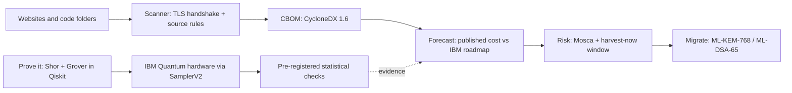

<div align="center">

# Straw Hat Pirates

**VTU-QFF-HC-0106** &nbsp;|&nbsp; Tier: **Online**

### Q-Day Time Machine

**Find the cryptography a quantum computer will break, see *when* it breaks, prove it on real IBM quantum hardware, and get the fix.**

</div>

---

<div align="center">

| | |
| :--- | :--- |
| **Team** | Straw Hat Pirates |
| **Team ID** | VTU-QFF-HC-0106 |
| **Tier** | Online |
| **Project** | Q-Day Time Machine |
| **Track** | Track 1: Quantum Cryptography & Security |
| **Repository** | [vtu-hc-straw-hat-pirates](https://github.com/vtu-qiskit-fall-fest-2026/vtu-hc-straw-hat-pirates.git) |
| **Organisation** | [vtu-qiskit-fall-fest-2026](https://github.com/vtu-qiskit-fall-fest-2026) |
| **Event** | VTU-QFF Hackathon — VTU-Qiskit Fall Fest 2026 |

</div>

---

## 📌 Table of Contents

- [Team Members](#-team-members-github-ids)
- [Problem Statement](#-problem-statement)
- [Proposed Solution](#-proposed-solution)
- [Approach & Architecture](#-approach--architecture)
- [Results on IBM Quantum Hardware](#-results-on-ibm-quantum-hardware)
- [Tech Stack](#-tech-stack)
- [Project Structure](#-project-structure)
- [How to Run](#-how-to-run)
- [Testing](#-testing)
- [Production Hardening](#-production-hardening)
- [Honest Limits](#-honest-limits)
- [How to Push Code](#-how-to-push-code)
- [Submission Checklist](#-submission-checklist)
- [Resources](#-resources)
- [References](#-references)
- [License](#-license)

---

## 👥 Team Members (GitHub IDs)

| # | Name | GitHub Username | Role |
| :-- | :--- | :--- | :--- |
| 1 | Raunak Kumar Gupta | [@Raunakg2005](https://github.com/Raunakg2005) | Team Lead |
| 2 | Krish Jain | [@krish2006-jain](https://github.com/krish2006-jain) | Developer |

---

## ❓ Problem Statement

**Problem:** Shor's algorithm breaks the RSA and elliptic-curve cryptography that protects today's logins,
payments and signatures, and attackers can already record encrypted traffic to decrypt later
("harvest now, decrypt later"). Organisations know this, but cannot answer the questions that drive
decisions: **which of my systems break first, in what year, and is the data I send today already at risk?**
Inventory tools list where cryptography is used; they do not turn that list into a timeline, a priority
order, or a proof.

**Why it matters:** NIST's draft transition plan (IR 8547) disallows RSA and elliptic-curve cryptography by
2035, and migrations take years. Data with a long shelf life (health records, finance, identity) is already
exposed if it is recorded today. Teams need to know where to start, and why to believe the timeline.

**Track / Category:** Online · Track 1 · Quantum Cryptography & Security · Problem statement: *Q-Day Time Machine*

---

## 💡 Proposed Solution

**Solution:** Q-Day Time Machine scans websites and source code for cryptography, exports a CycloneDX 1.6
Cryptography Bill of Materials, and compares each algorithm's published quantum attack cost with IBM's
fault-tolerant roadmap to show the year it becomes breakable. It then runs scaled-down Shor and Grover
attacks, built in Qiskit, on real IBM quantum computers, and demonstrates the NIST post-quantum
replacements working.

**Key idea:** Turn a crypto inventory into a **timeline**, checking logical qubits *and* gate counts year by
year against the IBM roadmap, and back the threat with **pre-registered experiments on IBM hardware**.

**Why this works:** Every finding gets a break year, a Mosca risk level (shelf life + migration time vs time
to break) and a concrete replacement, so teams know what to fix first. The hardware runs show the attacks
are real algorithms on real machines, and that they fade with noise, which is why real-size attacks need
the fault-tolerant machines on the roadmap.

| Step | What it does | Quantum / IBM piece |
| :--- | :--- | :--- |
| **1. Scan** | Reads live TLS endpoints (certificate key, CA key, negotiated key-exchange group, cipher) and source code in eight languages. | Detects the post-quantum hybrid group **X25519MLKEM768** |
| **2. CBOM** | Exports a **CycloneDX 1.6 Cryptography Bill of Materials** with a quantum-security level per algorithm. | CBOM format (IBM Research, now in CycloneDX) |
| **3. Time Machine** | A year slider compares each algorithm's published **logical-qubit and Toffoli-gate cost** with **IBM's roadmap** (Starling 2029, Blue Jay 2033+), so it can say "enough qubits, not enough operations yet". | IBM roadmap |
| **4. Risk** | **Mosca's inequality** and a **harvest-now window**: which recorded traffic becomes readable, and when. | — |
| **5. Prove it** | Scaled-down attacks: **Shor's order finding** factors N = 15 and 21, **Grover** recovers a toy block-cipher key. Run on simulators and **real IBM quantum hardware**, and stepped through gate by gate with **quantum-debugger**. | **Qiskit**, Aer, Qiskit Runtime `SamplerV2`, ibm_fez, ibm_kingston, ibm_marrakesh, [quantum-debugger](https://pypi.org/project/quantum-debugger/) |
| **6. Migrate** | Live **hybrid X25519 + ML-KEM-768** key exchange (FIPS 203) and **ML-DSA-65** signatures (FIPS 204) side by side with RSA-2048 and ECDSA P-256. | NIST PQC standards |

---

## 🧩 Approach & Architecture



1. **Input** — hostnames you own (validated against RFC 1123 before use) and/or a code folder.
2. **Preprocessing** — a TLS handshake through Python `ssl` and `openssl s_client` reads the certificate,
   issuer key and negotiated group; regex rules with key-size and curve extraction read the code.
3. **Quantum core** — Shor's order finding (quantum phase estimation + inverse QFT) and Grover key search
   on a toy S-box cipher, transpiled for and run on IBM backends with `SamplerV2`.
4. **Post-processing** — continued fractions and gcd recover the factors; Wilson intervals, exact binomial
   tests, Hellinger fidelity and a Grover iteration sweep decide pass or fail.
5. **Output** — a dashboard and CLI with findings, break years, risk levels, a CBOM file and the
   post-quantum replacement for each finding.

### Shor's algorithm (order finding) — `qday/quantum/shor.py`
- Quantum phase estimation over `f(x) = a^x mod N`: `n` counting qubits in superposition, a work register
  initialised to `|1⟩`, counting qubit *j* controls **multiply-by-a^(2^j) mod N**, then an inverse QFT
  (`QFTGate`) and measurement; continued fractions recover the period *r* and `gcd(a^(r/2) ± 1, N)` gives
  the factors.
- The multiplier circuit is **synthesised generically for any constant**, so the circuit never encodes the
  answer:
  - **N = 15**: every unit mod 15 is ±2^k, so multiplication is a bit rotation (built from the rotation's
    cycle decomposition, minimum swaps) plus bitwise NOT for negative units.
  - **Other N (e.g. 21)**: the permutation unitary `x → c·x mod N` (simulator scale).
- Every multiplier is checked on **every input** in the test suite.

### Grover key search — `qday/quantum/grover.py`
- Toy cipher `E_k(p) = S(p ⊕ k)` with a nonlinear S-box (PRESENT's 4-bit S-box; a 3-bit S-box for
  hardware). The oracle evaluates the cipher on a superposition of all keys using only the public pair
  (p, c), phase-flips keys with `E_k(p) = c`, and uncomputes; then the standard diffuser.
- About (π/4)·√(2ⁿ) oracle calls instead of up to 2ⁿ classical trials: the square-root speed-up that
  halves symmetric key strength (why AES-128 → AES-256).
- Success probability matches `sin²((2i+1)θ)` for every iteration count *i*, including overshoot.

### Inside the circuit with quantum-debugger — `qday/quantum/debug.py`
[quantum-debugger](https://pypi.org/project/quantum-debugger/) is our team lead's open-source quantum circuit
debugger (`pip install quantum-debugger`). We use it for two things:
- **An independent second simulator.** Every Shor and Grover circuit is transpiled to the gates its Qiskit
  adapter supports and re-simulated gate by gate by quantum-debugger's own state-vector engine. It agrees with
  Qiskit on every Shor base of 15 and every Grover key tested (largest difference 3 × 10⁻¹³), so the ideal distributions our
  hardware results are scored against do not rest on a single simulator. Conversion is exact or refused:
  if any gate would be skipped, it raises instead of silently dropping it.
- **Step-through view.** `QuantumDebugger` replays the Grover attack one gate at a time and stops after the
  Hadamards and after every oracle and diffuser. The dashboard's *Inside the circuit* view shows the amplitude
  of every key at each stop: the oracle flips the secret key's sign, the diffuser reflects every amplitude
  around the mean, and the key's probability after each iteration equals the sin² law.

---

## 🔬 Results on IBM Quantum Hardware

### Simulator (ideal)
- Shor factors 15 = 3 × 5 for bases a = 2, 7, 8, 11, 13 and 21 = 3 × 7, and correctly reports the a = 5,
  N = 21 case where `5³ ≡ −1 (mod 21)` gives no factor.
- Grover recovers **all 16** possible 4-bit keys and **all 8** 3-bit keys; P(success) at the optimum is
  0.961 (4-bit, 3 iterations) and 0.945 (3-bit, 2 iterations), equal to theory.

### First run — `ibm_marrakesh` (job `dbc82qvi0auc73ducseg`, 4,000 shots each, 8 s QPU time)

| Circuit | Two-qubit gates | Result | P(success) | Pure-noise / guess baseline |
| :--- | :--- | :--- | :--- | :--- |
| Shor N = 15, a = 7 | 173 | factors (3, 5), r = 4 | 0.682 | 0.375 |
| Shor N = 15, a = 2 | 177 | factors (3, 5), r = 4 | 0.682 | 0.375 |
| Shor N = 15, a = 13 | 177 | factors (3, 5), r = 4 | 0.716 | 0.375 |
| Grover 3-bit, 1 iteration | 71 | key 6 recovered (correct) | 0.545 | 0.125 |
| Grover 3-bit, 2 iterations | 143 | key 6 recovered (correct) | 0.463 | 0.125 |

The four most frequent Shor outcomes on hardware are exactly the ideal peaks y = 0, 2, 4, 6. The 4-bit
Grover circuit (450–1,400 two-qubit gates) loses its signal on today's noisy hardware, itself evidence that
attacking real keys needs fault-tolerant machines. Raw counts: `results/hardware_run.json`.

### Validation suite — three IBM quantum computers (`scripts/hardware_suite.py`)

17 circuits × 4,000 shots on each of **ibm_fez, ibm_kingston and ibm_marrakesh**: Shor for **every** base of
N = 15, Shor with 4 counting qubits, Grover for **all 8** possible 3-bit keys, and two negative controls.
A test passes only if its whole 95% Wilson interval lies above the noise / random-guess baseline.

| | ibm_fez | ibm_kingston | ibm_marrakesh |
| :--- | :--- | :--- | :--- |
| Shor tests passed (factors 3 × 5 found) | 7 / 7 | 7 / 7 | 7 / 7 |
| Shor success rate (noise baseline 37.5%) | 67–70% | 62–73% | 69–70% |
| Grover tests passed (correct key recovered) | 8 / 8 | 8 / 8 | 8 / 8 |
| Grover success rate (random guess 12.5%) | 56–64% | 59–68% | 38–45% |
| Control a = 14 (can never factor) | 0 factors (ok) | 0 factors (ok) | 0 factors (ok) |
| Control Grover, 0 iterations (should look random) | 12.7% (ok) | 12.4% (ok) | 12.3% (ok) |

**45 / 45 tests pass, both controls behave on every machine, largest p-value 7.5 × 10⁻²²⁰.** N = 21 was not
run on hardware: it compiles to ~6,500 two-qubit gates (N = 15 needs 173). Full statistics:
`results/hardware_suite.json`.

### Strict validation — pre-registered criteria (`scripts/hardware_strict.py`, `qday/quantum/validation.py`)

Every rule was fixed in code **before** the hardware runs (criteria version `strict-v1`), and Grover secrets
were drawn at random at submit time (blinded).

| Rule | Requirement |
| :--- | :--- |
| C1 Signal | exact binomial p < 0.05 / 42 (Bonferroni) **and** the whole 95% interval above the noise baseline |
| C2 Right answer wins | Shor: the most frequent outcomes are exactly the ideal ones. Grover: the secret is the most frequent key, at least 2× the runner-up |
| C3 Half signal survives | Hellinger fidelity to ideal ≥ that of a 50% ideal / 50% noise mixture |
| C4 Physics fingerprint | Grover sweep 0–4 iterations: Pearson r ≥ 0.9 with theory and a significant drop past the optimum |
| C5 Other qubits | the same circuits re-placed on other chip regions also pass C1–C3 |
| C6 Repeatability | an identical second job agrees (chi-square p > 0.001 for every circuit) |

| | ibm_kingston | ibm_fez | ibm_marrakesh |
| :--- | :--- | :--- | :--- |
| Every rule, all 14 tests | **14 / 14** | 11 / 14 | 9 / 14 |
| Shor (6 bases + 2 re-placements) | 8 / 8 | 8 / 8 | 8 / 8 |
| Grover (6 tests) | 6 / 6 | 3 / 6 | 1 / 6 |
| C4 fingerprint (r with theory) | pass (0.99) | pass (0.97) | pass (0.91) |
| C6 repeat run | pass (19/19 circuits agree) | not run | not run |

**Shor passed 24 / 24 strict tests on every machine and placement. Grover passed 10 / 18.** Every Grover run
beat random guessing (C1 passed 42 / 42), but placement mattered: on ibm_marrakesh the transpiler's
placement gave 22% success while another region gave 64% and passed every rule. Grover must keep quantum
phases coherent through ~140 two-qubit gates, so it is the first to suffer from noise. Full results:
`results/hardware_strict.json`; raw counts in `results/strict/`.

### Forecast (published estimates vs IBM roadmap)

| Asset | Logical qubits | Toffoli gates | IBM roadmap only | Roadmap + continued growth (hypothetical) |
| :--- | :--- | :--- | :--- | :--- |
| RSA-2048 (Gidney 2025) | 1,399 | 6.5 × 10⁹ | 2033: **qubits-ready**, not enough operations | breakable ≈ 2037 |
| ECC P-256 (Roetteler 2017, upper bound) | 2,330 | 1.3 × 10¹¹ | not breakable on roadmap | breakable ≈ 2042 |

Our own site (quantyxio.cloud) already negotiates **X25519MLKEM768**, so recorded traffic is protected, but
its certificate (ECDSA P-256, CA ECDSA P-384) is not: impersonation becomes possible once those signatures
can be forged.

---

## 🧰 Tech Stack

| Layer | Technology |
| :--- | :--- |
| Language | Python 3.11+ |
| Quantum SDK | Qiskit `>=2.1`, Qiskit Aer `>=0.17`, Qiskit IBM Runtime `>=0.41` (`SamplerV2`) |
| Quantum hardware | IBM Quantum: ibm_fez, ibm_kingston, ibm_marrakesh |
| Simulation | AerSimulator (ideal) and fake backends with device noise models |
| Post-quantum crypto | kyber-py (ML-KEM-768, FIPS 203), dilithium-py (ML-DSA-65, FIPS 204), cryptography (X25519, HKDF) |
| Circuit debugging | [quantum-debugger](https://pypi.org/project/quantum-debugger/) `>=1.1` (step-through, independent state-vector check) |
| Statistics | NumPy, SciPy (Wilson intervals, binomial and chi-square tests) |
| Dashboard | Streamlit, Plotly, pandas |
| Landing page | three.js, GSAP + ScrollTrigger, Lenis (from pinned CDN builds) |
| Web server | aiohttp: landing page at `/`, dashboard proxied at `/app/` on one port |
| Testing | pytest, Hypothesis, Streamlit AppTest, pytest-cov |
| Quality | ruff (with bandit security rules), GitHub Actions CI |
| Deployment | Docker (non-root, health check) |

---

## 📁 Project Structure

```text
vtu-hc-straw-hat-pirates/
├── README.md                 # This file
├── requirements.txt          # Python dependencies
├── pyproject.toml            # Package metadata, `qday` CLI entry point, tool config
├── Dockerfile                # Production image: landing at /, dashboard at /app/
├── serve.py                  # One-port server: landing page + proxied dashboard
├── app.py                    # Streamlit dashboard (Scan · Time Machine · Prove it · Migrate · Sources)
├── landing/                  # Landing page (three.js time tunnel) and its build script
├── qday/
│   ├── cli.py                # `qday` command-line tool
│   ├── safety.py             # hostname / port validation
│   ├── ui.py                 # dashboard styling and components
│   ├── quantum/              # shor.py, grover.py, runner.py, stats.py, validation.py, debug.py
│   ├── scanner/              # tls.py, code.py, cbom.py
│   ├── forecast/             # estimates.py, roadmap.py, risk.py
│   └── migrate/              # pqc.py (hybrid X25519 + ML-KEM-768, ML-DSA-65)
├── scripts/                  # IBM hardware runs: first run, 3-backend suite, strict suite
├── results/                  # raw hardware counts and reports
├── samples/legacy_app/       # deliberately vulnerable sample code for the scanner demo
├── tests/                    # 968 tests
└── .github/workflows/ci.yml  # lint + tests on Python 3.11 and 3.12
```

---

## 🚀 How to Run

### Prerequisites

- Python 3.11 or newer
- [Git](https://git-scm.com/downloads)
- OpenSSL 3.x on the PATH (lets the scanner read the negotiated key-exchange group)

### 1. Clone the repository

```bash
git clone https://github.com/vtu-qiskit-fall-fest-2026/vtu-hc-straw-hat-pirates.git
cd vtu-hc-straw-hat-pirates
```

### 2. Create a virtual environment

```bash
python3 -m venv .venv
source .venv/bin/activate        # Linux / macOS
# .venv\Scripts\activate         # Windows (PowerShell)
```

### 3. Install dependencies

```bash
pip install --upgrade pip
pip install -r requirements.txt
pip install -e .                 # installs the `qday` command
```

### 4. Run

```bash
python serve.py
```

Open http://localhost:8501/ for the landing page; **Launch the app** opens the dashboard at `/app/`.
On a server: `python serve.py --host 0.0.0.0 --port 8501`, or use Docker:

```bash
docker build -t qday .
docker run -p 8501:8501 qday
```

Behind nginx or Caddy, forward the whole site to port 8501 with websocket upgrade headers (the dashboard's
live updates use a websocket at `/app/_stcore/stream`). For dashboard-only development:
`streamlit run app.py`. After editing `landing/landing.html`, run `python landing/build.py`.

**Command line:**

```bash
qday scan --host example.com --path ./src            # findings, risk, break year, fix
qday scan --path ./src --fail-on critical            # exit 1 if critical findings: use it in CI
qday cbom --path ./src -o cbom.json                  # CycloneDX 1.6 CBOM
qday forecast RSA-2048 --scenario roadmap            # requirements + first break year
qday shor --N 15 --a 7                               # run Shor (aer, fake_marrakesh or ibm_<name>)
qday grover --bits 3 --secret 6
qday pqc                                             # hybrid X25519 + ML-KEM-768 handshake
```

Exit codes: 0 = ok, 1 = findings at or above `--fail-on`, 2 = invalid input or every target failed.

**IBM hardware (optional):** copy `.env.example` to `.env`, add your IBM Quantum API key, then

```bash
python scripts/run_hardware.py submit --backend ibm_least_busy && python scripts/run_hardware.py fetch
python scripts/hardware_suite.py submit --backend ibm_kingston   # 17-circuit validation suite
python scripts/hardware_strict.py simulate                       # strict suite dry run (no QPU)
python scripts/hardware_strict.py submit --backend ibm_kingston --repeat
```

`.env` is git-ignored and excluded from the Docker image; the key is read at runtime and never stored in code.

### 5. Run the tests

```bash
pytest -m "not network and not hardware"   # 966 offline tests
pytest -m network                          # 2 live checks against our own site
```

---

## 🧪 Testing

**968 tests, 96% line coverage.**

| Type | Tests | What it proves |
| :--- | :--- | :--- |
| Exhaustive quantum | 272 | Every modular multiplier on every input; Shor for every base of 15 and 21 against number theory; Grover for every plaintext and key against the exact sin² law; oracle and diffuser unitaries checked as matrices |
| Property-based (Hypothesis) | 20 functions, thousands of cases | Factors always multiply to N; recovered periods are true periods; bigger keys never break earlier; TVD is a metric; Wilson intervals contain the rate; ML-DSA signs any message |
| Catalog, forecast, risk | 193 | Exact paper values and formulas; roadmap for every year and scenario; the full Mosca truth table; harvest-now windows |
| Security and robustness | 94 | 30 hostile hostnames (injection, control chars, bad schemes) rejected; ports; binary/huge/non-UTF-8 files; symlink loops; deep nesting |
| TLS integration (local server) | 72 | Real handshakes with RSA-2048/3072, ECDSA P-256/P-384 and Ed25519 certificates; key-exchange parsing across OpenSSL versions |
| Scanner rules | 58 | 45 must-detect and 11 must-not-misfire cases across Python, JS/TS, Java, Go, Kotlin, Rust and config files |
| Post-quantum | 35 | ML-KEM / ML-DSA round trips, FIPS 203/204 sizes, tampered ciphertexts and signatures rejected |
| CLI | 28 | Outputs, `--fail-on` exit codes, CBOM export, injection and bad-input handling |
| Golden results | 26 | Every hardware claim in this README recomputed from the raw counts |
| Config and runner | 26 | Credential precedence, `.env` parsing, the token never printed, backend selection, batching |
| End-to-end app (AppTest) | 24 | The real dashboard driven headlessly: nothing prefilled, settings reset, every tab, the step-through view, bad inputs |
| quantum-debugger integration | 66 | Every Shor base of 15 and every 3-bit Grover key agree with Qiskit; step-through matches the sin² law for every key; the oracle flips only the key's sign and the diffuser reflects about the mean; lossy conversion is refused |
| Statistics and strict criteria | 27 | Pass rules accept good data and reject noise, on synthetic distributions |
| One-port server (`serve.py`) | 16 | Cookies, bodies, redirects, gzip, websocket subprotocols, >4 MB messages, 502 when the dashboard is down |
| Performance | 4 | 1,500-file scan < 15 s; 10,000 assets assessed < 3 s |
| Live network (opt-in) | 2 | Our own site uses X25519MLKEM768 key exchange but an ECDSA certificate |

**Bugs these tests found and fixed:** the scanner missed classic key exchange (`Peer Temp Key` wording in
OpenSSL 3.5), exactly the harvest-now risk the tool exists to flag; hostnames could reach OpenSSL as
options; a 95% interval could exclude the observed rate at 0% / 100%; the CLI split one `--host` value into
two hosts; a key-size switch crashed the dashboard; a missing folder reported "0 findings"; noisy N = 21
could freeze the UI.

---

## 🔒 Production Hardening

- **Input validation** (`qday/safety.py`): hostnames are checked against RFC 1123 / IP literals before use,
  blocking argument injection into `openssl s_client` (e.g. a "host" of `-proxy evil:8080`).
- **Scanner limits**: no symlink following, binary files skipped, 2 MB per-file and 50,000-file caps,
  vendored folders skipped, findings capped.
- **Certificate verification on by default**; `--insecure` only for internal self-signed endpoints.
- **CI** (`.github/workflows/ci.yml`): ruff lint (including bandit security rules), the offline test suite on
  Python 3.11 and 3.12 with coverage, and a CLI check that the vulnerable sample is flagged.
- **Container**: non-root user, health check, secrets and tests excluded from the image.

---

## 🚧 Honest Limits

- The Shor and Grover demos break **toy** instances (N = 15, 21; 3–4-bit keys), not production keys.
- Break years depend on published estimates and on IBM's stated intent; after 2033 the "trend" scenario is
  an explicit extrapolation. Comparing Toffoli counts with IBM's gate counts favours the attacker, so dates
  are cautious (early). Newer elliptic-curve estimates are lower than the 2017 upper bound used here.
- The code scanner is pattern-based: findings are leads for review, not proof of reachability.
- Only scan systems you own or are authorised to test.

---

## 🔁 How to Push Code

> Full walkthrough: **[Git & Collaboration Handbook](../vtu-hc-guide-git-and-collaboration)** — collaboration
> workflow, branches, pull requests, reviews and conflict resolution.

### Configure Git (first time only)

```bash
git config --global user.name  "Your Name"
git config --global user.email "you@example.com"
```

### Everyday workflow

```bash
# 1. Get the latest changes
git checkout main
git pull origin main

# 2. Create a branch for your work
git checkout -b feature/my-task

# 3. Commit your work
git add .
git commit -m "feat: add variational circuit for the search problem"

# 4. Push the branch
git push -u origin feature/my-task

# 5. Open a Pull Request on GitHub and request a review
#    https://github.com/vtu-qiskit-fall-fest-2026/vtu-hc-straw-hat-pirates/compare/main...feature/my-task

# 6. After approval, merge into main
git checkout main
git pull origin main
git branch -d feature/my-task
```

### Commit message convention

| Prefix | Meaning |
| :--- | :--- |
| `feat:` | New feature |
| `fix:` | Bug fix |
| `docs:` | Documentation only |
| `test:` | Adding or fixing tests |
| `refactor:` | Code restructure, no behaviour change |
| `chore:` | Build/config/dependency changes |

### Useful commands

```bash
git status              # what changed
git log --oneline -10   # recent commits
git diff                # review changes before committing
git stash               # shelve changes temporarily
git pull --rebase       # update your branch on top of main
```

### Collaborating on the same repo

- **Never push directly to `main`** — open a Pull Request.
- **Pull before you push** to avoid rejected commits.
- **Commit often** with clear messages.
- **Resolve conflicts** locally: `git pull --rebase`, fix the files, then `git add` + `git rebase --continue`.
- **Ask for a review** before merging — a second pair of eyes catches bugs fast.

---

## ✅ Submission Checklist

- [x] Repository created and **public**
- [ ] All team members added as **collaborators** and invitations accepted
- [x] `README.md` updated with project details, problem statement and solution
- [x] Team members listed under [Team Members](#-team-members-github-ids)
- [x] `requirements.txt` committed and project runs from a clean clone
- [ ] Code pushed to `main` and the latest `main` builds successfully
- [x] Notebooks committed with **cleared outputs** (no notebooks in this project)
- [ ] `README` includes a demo screenshot / video link
- [ ] Short project summary submitted on the hackathon portal

---

## 📚 Resources

| Resource | Link |
| :--- | :--- |
| 🔁 Git & collaboration handbook | [Git & Collaboration Handbook](../vtu-hc-guide-git-and-collaboration) |
| ❓ Problem statements, solutions & terms | [Problem Statements, Solutions & Terms](../vtu-hc-guide-problem-and-solution) |
| 📄 README writing guide | [README Guide & Template](../vtu-hc-guide-readme-template) |
| ⚛️ Qiskit documentation | https://docs.quantum.ibm.com/ |
| ⚛️ Qiskit Runtime & primitives | https://quantum.cloud.ibm.com/docs/ |
| 🧪 Qiskit Aer simulator | https://docs.quantum.ibm.com/guides/simulator |
| 💻 IBM Quantum Platform | https://quantum.cloud.ibm.com/ |
| 🎓 Qiskit textbook | https://qiskit.qotlabs.org/learning/ |
| 📋 GitHub Docs | https://docs.github.com/ |

---

## 📖 References

- C. Gidney, *How to factor 2048 bit RSA integers with less than a million noisy qubits*, arXiv:2505.15917 (2025)
- C. Gidney, M. Ekerå, *How to factor 2048 bit RSA integers in 8 hours using 20 million noisy qubits*, arXiv:1905.09749 (2019)
- M. Roetteler, M. Naehrig, K. Svore, K. Lauter, *Quantum resource estimates for computing elliptic curve discrete logarithms*, arXiv:1706.06752 (2017)
- IBM Quantum roadmap, https://www.ibm.com/roadmaps/quantum/
- NIST FIPS 203 (ML-KEM) and FIPS 204 (ML-DSA); NIST IR 8547 (initial public draft, 2024); CycloneDX 1.6 CBOM
- M. Mosca, *Cybersecurity in an era with quantum computers: will we be ready?* (2018)

**Open-source libraries used:** Qiskit, Qiskit Aer, Qiskit IBM Runtime, quantum-debugger, cryptography, kyber-py (ML-KEM),
dilithium-py (ML-DSA), Streamlit, Plotly, pandas, NumPy, SciPy, aiohttp, three.js, GSAP, Lenis, pytest,
Hypothesis.

---

## 📄 License

Released under the [MIT License](LICENSE). See `LICENSE` for details.

---

<div align="center">

**Straw Hat Pirates** · Team ID `VTU-QFF-HC-0106` · Tier `Online`
· Built with ⚛️ Qiskit for the VTU-QFF Hackathon

[⬆ Back to Top](#straw-hat-pirates)

</div>
