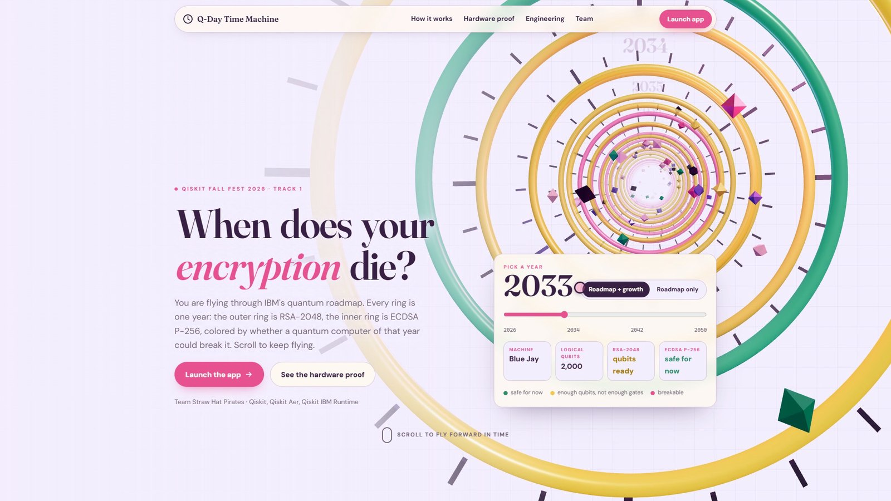
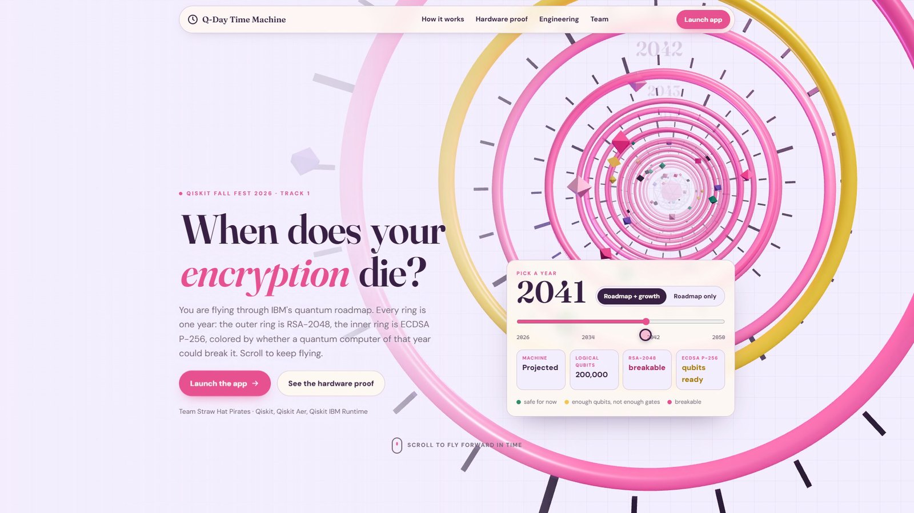
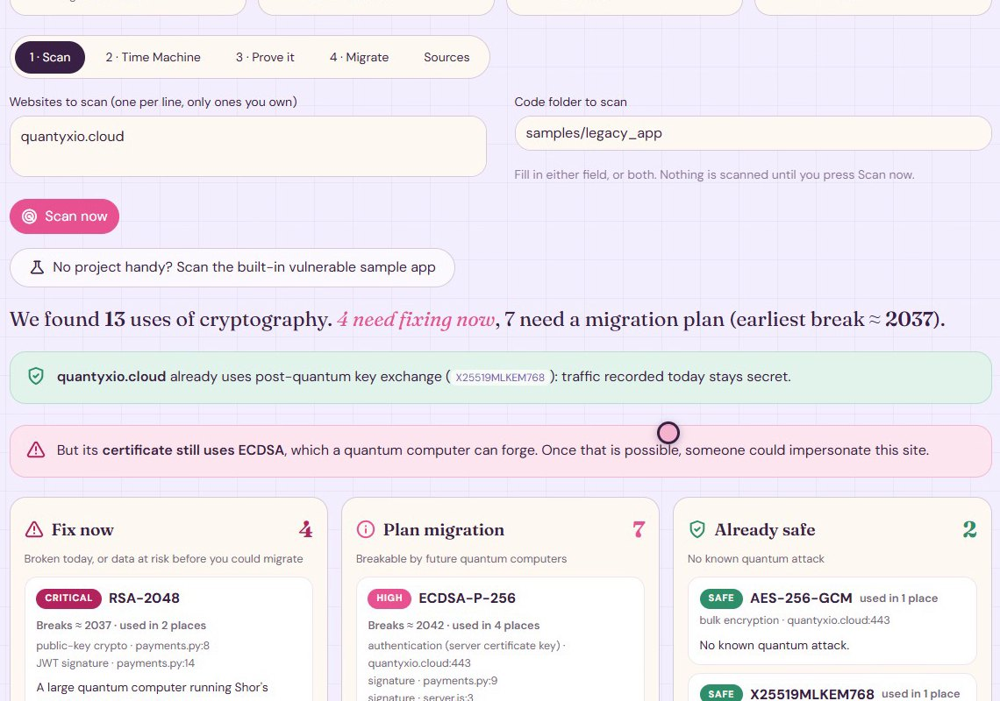
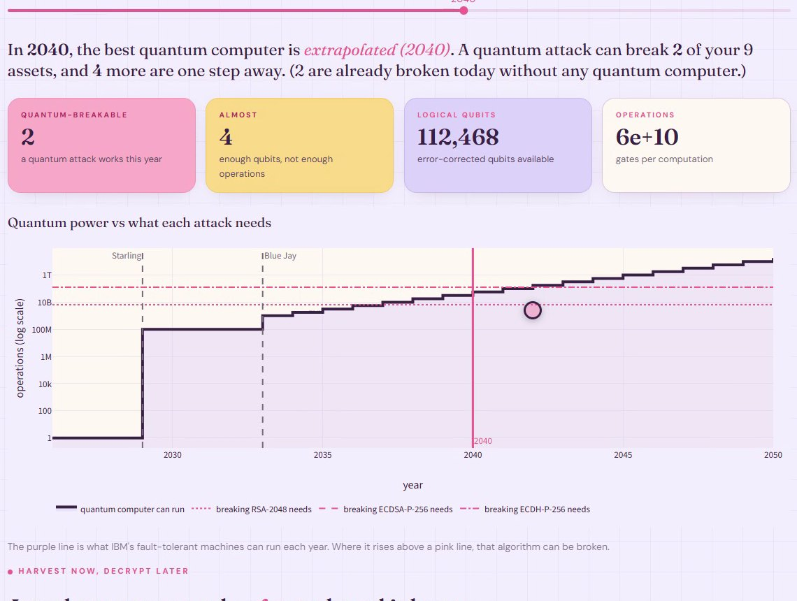
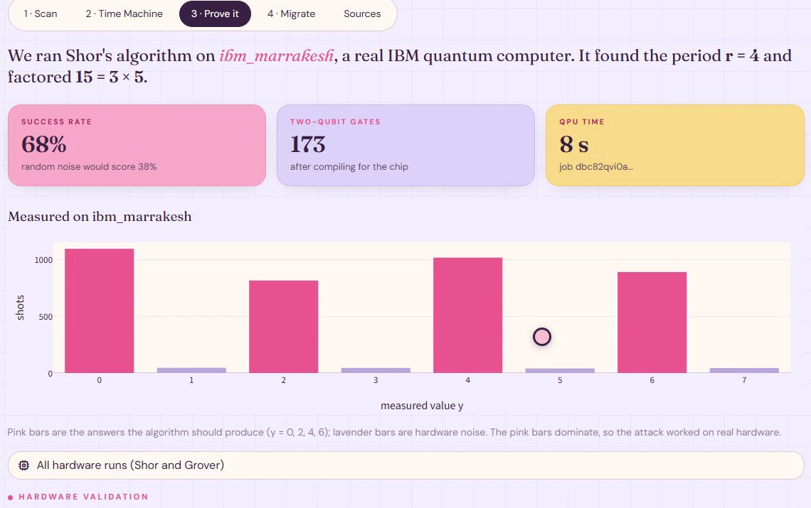
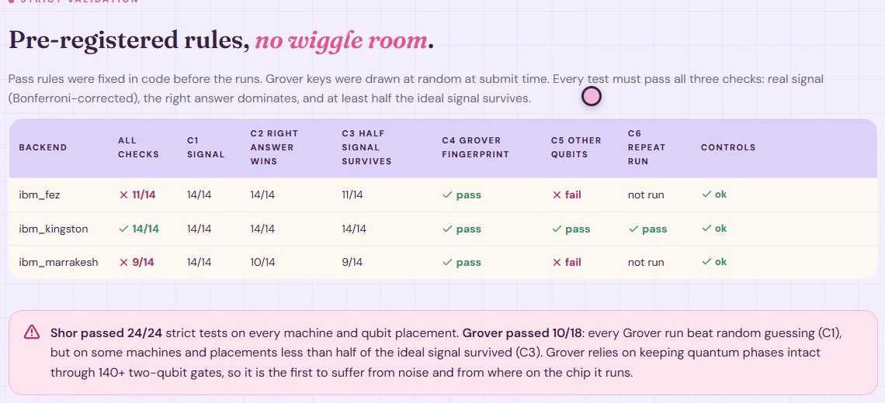
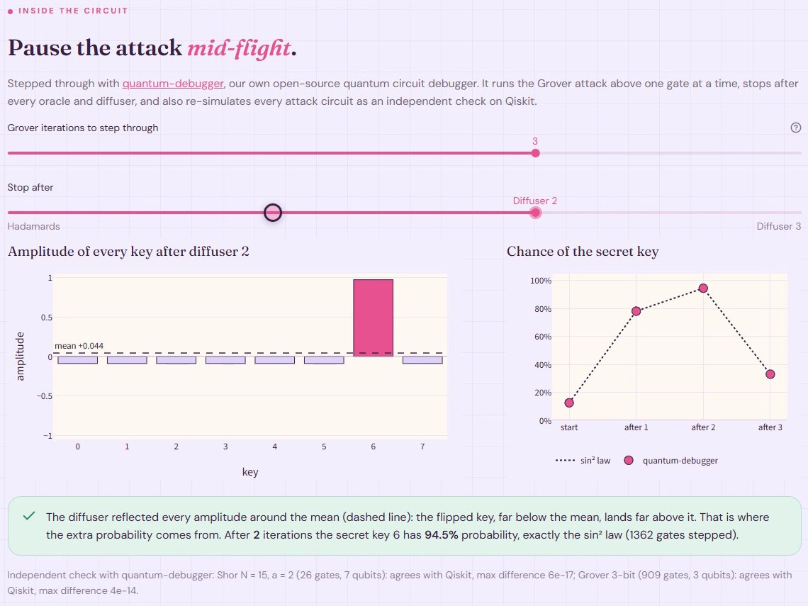
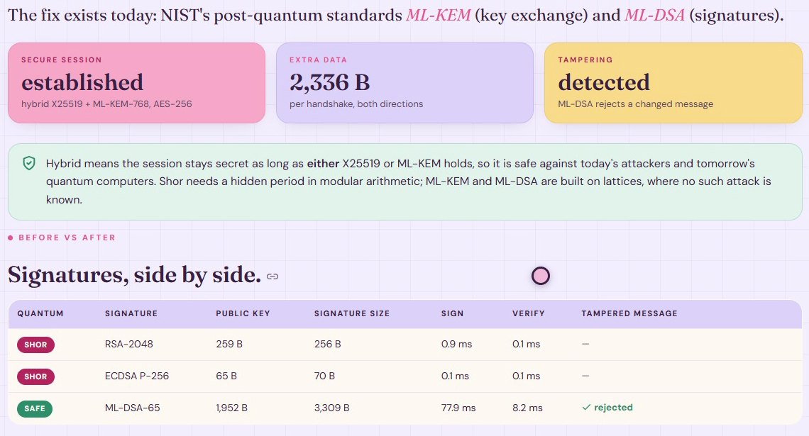
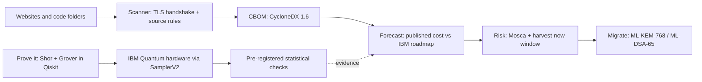

<div align="center">

# Q-Day Time Machine

**Find the cryptography a quantum computer will break, see *when* it breaks, prove it on real IBM quantum hardware, and get the fix.**

Team **Straw Hat Pirates** · `VTU-QFF-HC-0106` · Online · Track 1: Quantum Cryptography & Security
VTU-QFF Hackathon — Qiskit Fall Fest 2026

[](https://youtu.be/8AHgcPisYlE)

**[▶ Watch the demo (2 min)](https://youtu.be/8AHgcPisYlE)** &nbsp;·&nbsp;
**[Presentation (PPTX)](docs/Q-Day_Time_Machine_VTU-QFF-HC-0106.pptx)** &nbsp;·&nbsp;
**[Run it in 3 commands](#quick-start)**

</div>

---

## At a glance

| | |
| :--- | :--- |
| **Problem** | "Harvest now, decrypt later": recorded traffic protected by RSA and elliptic-curve cryptography becomes readable once a large quantum computer exists. Teams can't say which systems break first, or when. |
| **What we built** | A scanner, a year-by-year break forecast against IBM's quantum roadmap, Shor and Grover attacks run on real IBM hardware, and the NIST post-quantum fix, in one dashboard and CLI. |
| **Hardware proof** | **45 / 45** validation tests passed on **ibm_fez, ibm_kingston and ibm_marrakesh**; Shor factored 15 = 3 × 5 on every machine (24 / 24 strict tests). |
| **Engineering** | **969 tests**, 96% line coverage, CI on Python 3.11 and 3.12, Docker image, `qday` CLI that can gate CI. |
| **Our library** | [quantum-debugger](https://pypi.org/project/quantum-debugger/) re-simulates every attack circuit as an independent check on Qiskit and powers a gate-by-gate step-through view. |

---

## Contents

- [The problem](#the-problem)
- [The solution](#the-solution)
- [Screenshots](#screenshots)
- [How it works](#how-it-works)
- [Results on IBM quantum hardware](#results-on-ibm-quantum-hardware)
- [Quick start](#quick-start)
- [Command line](#command-line)
- [Testing](#testing)
- [Tech stack](#tech-stack)
- [Project structure](#project-structure)
- [Security and production hardening](#security-and-production-hardening)
- [Limitations](#limitations)
- [Team](#team)
- [Submission checklist](#submission-checklist)
- [References](#references)

---

## The problem

Shor's algorithm breaks the RSA and elliptic-curve cryptography behind today's logins, payments and
signatures. Attackers can already record encrypted traffic and decrypt it later. NIST's draft transition plan
(IR 8547) retires RSA and elliptic-curve cryptography by **2035**, and migrations take years, so data with a
long shelf life (health, finance, identity) is exposed today.

Organisations know this, but can't answer the questions that drive decisions:

- **Which** of my systems break first?
- **In what year** do they break?
- **Is the data I send today** already at risk?

Inventory tools list where cryptography is used. They don't turn that list into a timeline, a priority
order or a proof.

## The solution

| Step | What it does | Quantum / IBM piece |
| :--- | :--- | :--- |
| **1. Scan** | Reads live TLS endpoints (certificate key, CA key, key-exchange group, cipher) and source code in eight languages | Detects the hybrid post-quantum group **X25519MLKEM768** |
| **2. Inventory** | Exports a **CycloneDX 1.6 Cryptography Bill of Materials** with a quantum-security level per algorithm | CBOM format (from IBM Research) |
| **3. Time Machine** | A year slider compares each algorithm's published **logical-qubit and Toffoli-gate cost** with **IBM's roadmap** (Starling 2029, Blue Jay 2033+) | IBM fault-tolerant roadmap |
| **4. Risk** | **Mosca's inequality** and a harvest-now window: which recorded traffic becomes readable, and when | — |
| **5. Prove it** | Scaled-down **Shor** (factors 15 and 21) and **Grover** (recovers a toy cipher key), run on simulators and **real IBM quantum computers**, stepped through gate by gate | Qiskit, Aer, Qiskit Runtime `SamplerV2`, quantum-debugger |
| **6. Migrate** | Live hybrid **X25519 + ML-KEM-768** key exchange (FIPS 203) and **ML-DSA-65** signatures (FIPS 204) beside RSA-2048 and ECDSA P-256 | NIST post-quantum standards |

**What's new:** a *timeline*, not just an inventory (qubits **and** gate counts, year by year); hardware tests
with pass rules **fixed in code before the runs**; circuits that **never encode the answer**; and a **second,
independent simulator** checking every circuit.

---

## Screenshots

**Landing page: fly through IBM's roadmap.** Each ring is one year; the outer ring is RSA-2048, the inner
ring ECDSA P-256, green while safe and pink once breakable.

<p align="center">
  
  
</p>

<table>
<tr>
<td width="50%"><b>1 · Scan</b>: our own website uses post-quantum key exchange, but its ECDSA certificate is breakable; code findings are sorted by what to fix first.<br><br></td>
<td width="50%"><b>2 · Time Machine</b>: the best quantum computer each year against what each attack needs.<br><br></td>
</tr>
<tr>
<td><b>3 · Prove it</b>: Shor's algorithm factoring 15 on ibm_marrakesh; the pink bars are the correct answers.<br><br></td>
<td><b>Strict validation</b>: pre-registered pass rules across three IBM quantum computers.<br><br></td>
</tr>
<tr>
<td><b>Inside the circuit</b>: quantum-debugger pauses Grover's attack after each oracle and diffuser.<br><br></td>
<td><b>4 · Migrate</b>: a working hybrid ML-KEM handshake and ML-DSA signatures beside RSA and ECDSA.<br><br></td>
</tr>
</table>

---

## How it works



### Shor's algorithm (order finding) — `qday/quantum/shor.py`
- Quantum phase estimation over `f(x) = aˣ mod N`: counting qubit *j* controls **multiply by a^(2^j) mod N**,
  then an inverse QFT; continued fractions give the period *r*, and `gcd(a^(r/2) ± 1, N)` the factors.
- The multiplier is **synthesised for any constant**, so the circuit never encodes the answer. For N = 15 every
  unit is ±2ᵏ, so multiplication is a bit rotation plus NOT (173 two-qubit gates on hardware); other N use a
  permutation unitary (simulator scale). Every multiplier is checked on every input.

### Grover key search — `qday/quantum/grover.py`
- Toy cipher `E_k(p) = S(p ⊕ k)` with a nonlinear S-box (PRESENT's 4-bit S-box; 3-bit on hardware). The
  oracle runs the cipher on every key at once and flips the phase of keys with `E_k(p) = c`; the diffuser
  reflects about the mean.
- About (π/4)·√(2ⁿ) oracle calls instead of up to 2ⁿ trials: the square-root speed-up that halves symmetric
  key strength (why AES-256 is advised over AES-128). Success follows `sin²((2i+1)θ)`, including overshoot.

### Independent check with quantum-debugger — `qday/quantum/debug.py`
[quantum-debugger](https://pypi.org/project/quantum-debugger/) is our team lead's open-source circuit debugger.
- **Second simulator:** every Shor and Grover circuit is re-simulated gate by gate by its own state-vector
  engine. It agrees with Qiskit on every Shor base of 15 and every Grover key tested (largest difference
  3 × 10⁻¹³). Conversion is exact or refused: it never silently drops a gate.
- **Step-through:** the dashboard pauses Grover after every oracle and diffuser and shows each key's amplitude:
  the oracle flips the secret key's sign, and the diffuser turns that into probability.

---

## Results on IBM quantum hardware

### First run — `ibm_marrakesh` (4,000 shots each, 8 s of QPU time)

| Circuit | Two-qubit gates | Result | Success | Noise / guess baseline |
| :--- | ---: | :--- | ---: | ---: |
| Shor N = 15, a = 7 | 173 | factors (3, 5), r = 4 | 68.2% | 37.5% |
| Shor N = 15, a = 2 | 177 | factors (3, 5), r = 4 | 68.2% | 37.5% |
| Shor N = 15, a = 13 | 177 | factors (3, 5), r = 4 | 71.6% | 37.5% |
| Grover 3-bit, 1 iteration | 71 | key 6 recovered | 54.5% | 12.5% |
| Grover 3-bit, 2 iterations | 143 | key 6 recovered | 46.3% | 12.5% |

The four most frequent Shor outcomes are exactly the ideal peaks y = 0, 2, 4, 6.

### Validation suite — three IBM quantum computers (`scripts/hardware_suite.py`)

17 circuits × 4,000 shots on each machine: Shor for every base of 15, Grover for all 8 three-bit keys, and two
negative controls that must fail. A test passes only if its whole 95% Wilson interval is above the noise
baseline.

| | ibm_fez | ibm_kingston | ibm_marrakesh |
| :--- | :---: | :---: | :---: |
| Shor (factors 3 × 5 found) | 7 / 7 | 7 / 7 | 7 / 7 |
| Grover (correct key recovered) | 8 / 8 | 8 / 8 | 8 / 8 |
| Grover success (random guess 12.5%) | 56–64% | 59–68% | 38–45% |
| Both negative controls | ok | ok | ok |

**45 / 45 tests pass; the largest p-value is 7.5 × 10⁻²²⁰.**

### Strict validation — rules fixed before the runs (`scripts/hardware_strict.py`)

Six rules (criteria `strict-v1`, in `qday/quantum/validation.py`): a Bonferroni-corrected signal test, the right
answer must dominate, at least half the ideal signal must survive, Grover's iteration curve must match theory
(Pearson r ≥ 0.9), other qubit placements must also pass, and a repeat job must agree. Grover secrets were
drawn blind at submit time.

| | ibm_kingston | ibm_fez | ibm_marrakesh |
| :--- | :---: | :---: | :---: |
| Every rule, all 14 tests | **14 / 14** | 11 / 14 | 9 / 14 |
| Shor | 8 / 8 | 8 / 8 | 8 / 8 |
| Grover | 6 / 6 | 3 / 6 | 1 / 6 |
| Grover curve vs theory (r) | 0.99 | 0.97 | 0.91 |

**Shor passed 24 / 24 strict tests. Grover passed 10 / 18:** every Grover run beat random guessing, but where it
ran on the chip mattered (22% vs 64% on two qubit sets of ibm_marrakesh). Grover keeps quantum phases through
~140 two-qubit gates, so it is the first to suffer from noise, which is why real attacks need fault-tolerant
machines. Raw counts and reports are in [`results/`](results/).

### Forecast — published attack cost vs IBM's roadmap

| Target | Logical qubits | Toffoli gates | IBM roadmap only | Roadmap + continued growth (hypothetical) |
| :--- | ---: | ---: | :--- | :--- |
| RSA-2048 (Gidney 2025) | 1,399 | 6.5 × 10⁹ | 2033: enough qubits, not enough operations | breakable ≈ **2037** |
| ECDSA P-256 (Roetteler 2017, upper bound) | 2,330 | 1.3 × 10¹¹ | not breakable on the roadmap | breakable ≈ **2042** |

---

## Quick start

Requires Python 3.11+ and OpenSSL 3.x on the PATH.

```bash
git clone https://github.com/vtu-qiskit-fall-fest-2026/vtu-hc-straw-hat-pirates.git && cd vtu-hc-straw-hat-pirates
pip install -r requirements.txt && pip install -e .
python serve.py
```

Open **http://localhost:8501/** for the landing page; **Launch the app** opens the dashboard at `/app/`.
No IBM account is needed: the hardware results are included in [`results/`](results/).

**Docker:**

```bash
docker build -t qday . && docker run -p 8501:8501 qday
```

**On a server:** `python serve.py --host 0.0.0.0 --port 8501`. Behind nginx or Caddy, forward the whole site to
port 8501 with websocket upgrade headers (the dashboard's live updates use `/app/_stcore/stream`).

**Run on IBM hardware yourself (optional):** copy `.env.example` to `.env`, add your IBM Quantum API key, then
run `python scripts/hardware_suite.py submit --backend ibm_kingston`. `.env` is git-ignored and never baked into
the Docker image.

## Command line

```bash
qday scan --host example.com --path ./src     # findings, risk, break year and the fix
qday scan --path ./src --fail-on critical     # exits 1 on critical findings: use it as a CI gate
qday cbom --path ./src -o cbom.json           # CycloneDX 1.6 cryptography bill of materials
qday forecast RSA-2048 --scenario roadmap     # requirements and first break year
qday shor --N 15 --a 7                        # run Shor (aer, fake_marrakesh or ibm_<name>)
qday grover --bits 3 --secret 6               # run Grover
qday pqc                                      # hybrid X25519 + ML-KEM-768 handshake
```

Exit codes: 0 ok, 1 findings at or above `--fail-on`, 2 invalid input or every target failed.

---

## Testing

```bash
pytest -m "not network and not hardware"   # 967 offline tests
pytest -m network                          # 2 live checks against our own site
```

**969 tests, 96% line coverage.**

| Type | Tests | What it proves |
| :--- | ---: | :--- |
| Exhaustive quantum | 272 | Every modular multiplier on every input; Shor for every base of 15 and 21; Grover for every key against the exact sin² law |
| Forecast and risk | 193 | Exact paper values; the roadmap for every year and scenario; the full Mosca truth table |
| Security and robustness | 94 | 30 hostile hostnames rejected; binary, huge and non-UTF-8 files; symlink loops |
| TLS integration | 72 | Real handshakes with RSA, ECDSA and Ed25519 certificates on a local server |
| quantum-debugger integration | 67 | Every Shor base and Grover key agrees with Qiskit; the step-through matches theory |
| Scanner rules | 58 | Must-detect and must-not-misfire cases across eight languages |
| Post-quantum | 35 | ML-KEM / ML-DSA round trips; tampered ciphertexts and signatures rejected |
| CLI | 28 | Outputs, `--fail-on` exit codes, CBOM export, bad input |
| Statistics and strict criteria | 27 | Pass rules accept good data and reject noise |
| Golden results | 26 | Every hardware number in this README recomputed from the raw counts |
| Config and runner | 26 | Credential handling (the token is never printed), backend selection |
| Dashboard (AppTest) | 24 | The real dashboard driven headlessly: every tab, bad inputs, the step-through |
| Property-based (Hypothesis) | 20 | Thousands of generated cases: factors multiply to N, intervals contain the rate |
| Web server | 16 | Landing at `/`, dashboard at `/app/`: websockets, large messages, dashboard down |
| Performance | 4 | 1,500-file scan in under 15 s; 10,000 assets assessed in under 3 s |
| Live network (opt-in) | 2 | Our own site: post-quantum key exchange but an ECDSA certificate |

**Bugs these tests caught and we fixed:** the scanner missed classic key exchange in OpenSSL 3.5 output (the
exact risk the tool exists to flag); hostnames could reach OpenSSL as command options; a confidence interval
could exclude the observed rate; the CLI split one `--host` value in two; a key-size switch crashed the
dashboard; a missing folder reported "0 findings".

---

## Tech stack

| Layer | Technology |
| :--- | :--- |
| Quantum | Qiskit ≥ 2.1, Qiskit Aer, Qiskit IBM Runtime (`SamplerV2`); IBM Quantum ibm_fez, ibm_kingston, ibm_marrakesh |
| Circuit checking | [quantum-debugger](https://pypi.org/project/quantum-debugger/) ≥ 1.1 |
| Post-quantum crypto | kyber-py (ML-KEM-768, FIPS 203), dilithium-py (ML-DSA-65, FIPS 204), cryptography (X25519, HKDF) |
| Statistics | NumPy, SciPy (Wilson intervals, binomial and chi-square tests) |
| Dashboard | Streamlit, Plotly, pandas |
| Landing page | three.js, GSAP, Lenis |
| Server | aiohttp: landing page and dashboard on one port |
| Quality | pytest, Hypothesis, ruff (with security rules), GitHub Actions, Docker |

## Project structure

```text
├── app.py                    # Streamlit dashboard: Scan · Time Machine · Prove it · Migrate · Sources
├── serve.py                  # one-port server: landing page at /, dashboard at /app/
├── landing/                  # three.js landing page and its build script
├── qday/
│   ├── cli.py                # `qday` command-line tool
│   ├── safety.py             # hostname / port validation
│   ├── scanner/              # TLS profile, source-code rules, CBOM export
│   ├── forecast/             # published estimates, IBM roadmap, risk (Mosca)
│   ├── quantum/              # Shor, Grover, IBM runner, statistics, strict criteria, quantum-debugger check
│   └── migrate/              # hybrid X25519 + ML-KEM-768, ML-DSA-65
├── scripts/                  # IBM hardware runs: first run, 3-backend suite, strict suite
├── results/                  # raw hardware counts and reports
├── samples/legacy_app/       # deliberately vulnerable code for the scanner demo
├── docs/                     # presentation and README screenshots
├── tests/                    # 969 tests
├── Dockerfile                # production image
└── .github/workflows/ci.yml  # lint and tests on Python 3.11 and 3.12
```

## Security and production hardening

- **Input validation:** hostnames are checked against RFC 1123 before use, blocking argument injection into
  `openssl s_client` (for example a "host" of `-proxy evil:8080`).
- **Scanner limits:** no symlink following, binary files skipped, per-file and file-count caps.
- **Certificate verification on by default**; `--insecure` only for internal self-signed endpoints.
- **Secrets:** the IBM key is read at runtime from `.env`, which is git-ignored and excluded from the image.
- **Container:** non-root user and a health check. **CI:** lint with security rules and the full offline suite.

## Limitations

- The attacks break **toy** instances (N = 15 and 21; 3–4-bit keys), not production keys.
- Break years rest on published estimates and IBM's stated roadmap; after 2033 the growth scenario is an
  explicit extrapolation. Newer elliptic-curve estimates are lower than the 2017 bound used here.
- The code scanner is pattern-based: findings are leads to review, not proof of reachability.
- Only scan systems you own or are authorised to test.

---

## Team

| Name | GitHub | Role |
| :--- | :--- | :--- |
| Raunak Kumar Gupta | [@Raunakg2005](https://github.com/Raunakg2005) | Team Lead |
| Krish Jain | [@krish2006-jain](https://github.com/krish2006-jain) | Developer |

KJ Somaiya College of Engineering, India.

## Submission checklist

- [x] Repository created and **public**
- [ ] All team members added as **collaborators** and invitations accepted
- [x] README with project details, problem statement and solution
- [x] Team members listed
- [x] `requirements.txt` committed and the project runs from a clean clone
- [ ] Code merged to `main` and the latest `main` builds successfully
- [x] No notebooks (nothing to clear)
- [x] Demo video and screenshots in the README
- [ ] Short project summary submitted on the hackathon portal

## References

- C. Gidney, *How to factor 2048 bit RSA integers with less than a million noisy qubits*, [arXiv:2505.15917](https://arxiv.org/abs/2505.15917) (2025)
- C. Gidney, M. Ekerå, *How to factor 2048 bit RSA integers in 8 hours using 20 million noisy qubits*, [arXiv:1905.09749](https://arxiv.org/abs/1905.09749) (2019)
- M. Roetteler et al., *Quantum resource estimates for computing elliptic curve discrete logarithms*, [arXiv:1706.06752](https://arxiv.org/abs/1706.06752) (2017)
- [IBM Quantum roadmap](https://www.ibm.com/roadmaps/quantum/)
- NIST [FIPS 203](https://csrc.nist.gov/pubs/fips/203/final) (ML-KEM), [FIPS 204](https://csrc.nist.gov/pubs/fips/204/final) (ML-DSA), [IR 8547](https://csrc.nist.gov/pubs/ir/8547/ipd) (initial public draft, 2024); [CycloneDX 1.6](https://cyclonedx.org/docs/1.6/json/)
- M. Mosca, *Cybersecurity in an era with quantum computers: will we be ready?*, IEEE Security & Privacy (2018)

## License

Released under the [MIT License](LICENSE).

<div align="center">

**Straw Hat Pirates** · `VTU-QFF-HC-0106` · Built with Qiskit for the VTU-QFF Hackathon, Qiskit Fall Fest 2026

</div>
